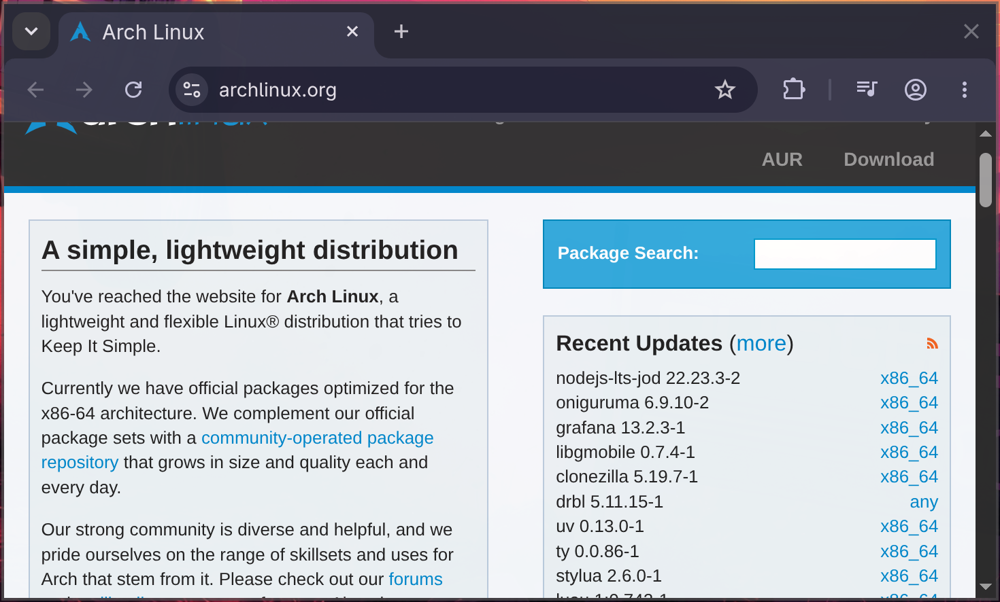
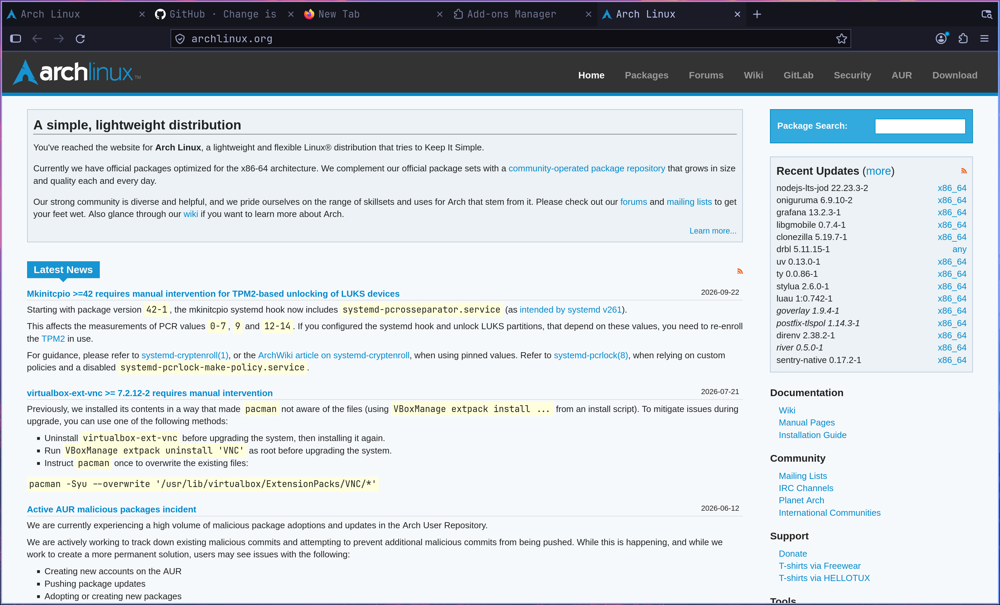

# omarchy-firefox-theme

Makes Firefox look like the rest of [Omarchy](https://omarchy.org): square corners, flat surfaces, the current theme's palette and the Omarchy monospace font, in the browser UI and on the built-in `about:` pages.

| Stock Chromium on Omarchy | Firefox with this theme (Tokyo Night) |
|---|---|
|  |  |

## What it does

- Reads `~/.local/state/omarchy/current/theme/colors.toml` and `omarchy font current`
- Writes `user.js`, `chrome/userChrome.css` and `chrome/userContent.css` into every Firefox profile
- Square corners everywhere: tabs, URL bar, suggestions, menus, panels, buttons
- Works with dark and light themes (tested with Tokyo Night, Rose Pine, White)
- The active tab merges into the toolbar (no accent line that would clash with the Hyprland border)
- Hides window buttons, Firefox View, and sponsored or weather content on the new tab page

## Install

```bash
omarchy install browser firefox      # if Firefox isn't installed yet; start it once, then close it
install -Dm755 omarchy-firefox-theme ~/.local/bin/omarchy-firefox-theme
printf '#!/bin/bash\nomarchy-firefox-theme >/dev/null 2>&1 || true\n' > /tmp/firefox-theme.sh
omarchy hook install theme-set /tmp/firefox-theme.sh
omarchy hook install font-set /tmp/firefox-theme.sh
omarchy-firefox-theme
```

Restart Firefox to see the result. After that, the hooks regenerate the theme on every `omarchy theme set` and `omarchy font set` (Firefox needs a restart to pick it up).

## Caveats

- `userChrome.css` isn't officially supported, and Firefox renames its internal CSS variables from time to time. This version targets Firefox 157.
- The script overwrites `user.js` in each profile. Prefs set through the Firefox settings UI are unaffected.
